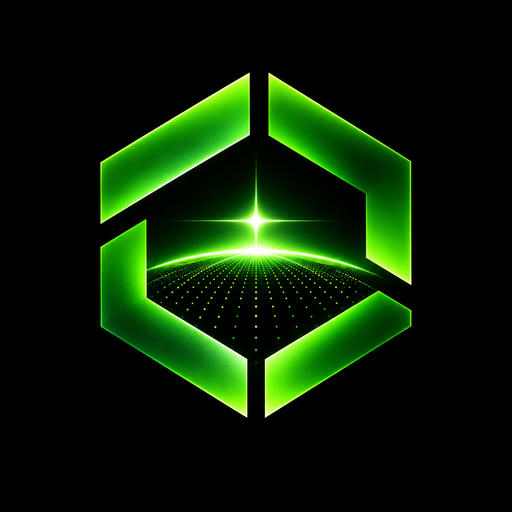

  

<h3 align="center">Open infrastructure for collective frontier intelligence</h3>

  <b><a href="https://github.com/OpenFrontierLabs/openfrontier">github.com/OpenFrontierLabs/openfrontier</a></b>

Open Frontier Labs is a community-owned open-weights lab. It is what OpenAI should have been, with a pure community vibe: the work is public, the people who contribute own it together, and nobody sits between the community and the model.

> **We are just starting. Nothing has been trained yet.** There are no models, results or benchmarks to point at. What exists today is a plan and an empty repo to build it in.

## The three pillars

**Open Infrastructure.** Trainers, data pipelines, the node agent and dashboards, all in public repos. If we need a tool to train a model, you can read it, run it and fix it.

**Distributed Compute.** We intend to train on compute the community pools: pretraining and asynchronous reinforcement learning spread across GPUs that people donate or contribute. The techniques exist in public research; putting them to work as one open effort is the part we are trying to do. Whether it works at useful scale is something we will find out, in public.

**Intelligence Research and Exploration.** Our own base models, evals and post-training, with negative results published alongside the good ones. We aim for the best model we can make at each size, not parity with closed frontier labs.

## What is open

Data recipes, code, configs, training logs, intermediate checkpoints and final weights, released as they happen. Code and weights are licensed under **Apache-2.0**.

## Join in

- **Contribute code:** see [CONTRIBUTING](https://github.com/OpenFrontierLabs/openfrontier/blob/main/CONTRIBUTING.md).
- **Contribute compute:** see [docs/join-a-node.md](https://github.com/OpenFrontierLabs/openfrontier/blob/main/docs/join-a-node.md), or open a [compute offer](https://github.com/OpenFrontierLabs/openfrontier/issues/new/choose).
- **Build RL environments:** environments for training and evaluating models are open work for anyone.
- **Read the manifesto:** [MANIFESTO.md](https://github.com/OpenFrontierLabs/openfrontier/blob/main/MANIFESTO.md).

Start at **[OpenFrontierLabs/openfrontier](https://github.com/OpenFrontierLabs/openfrontier)**.
